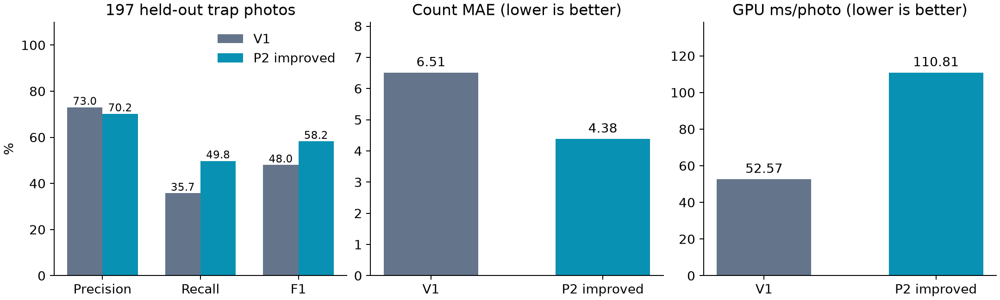
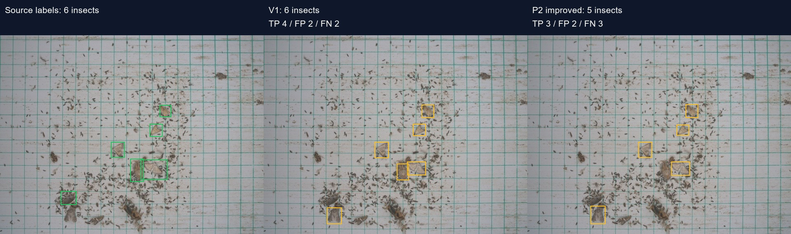
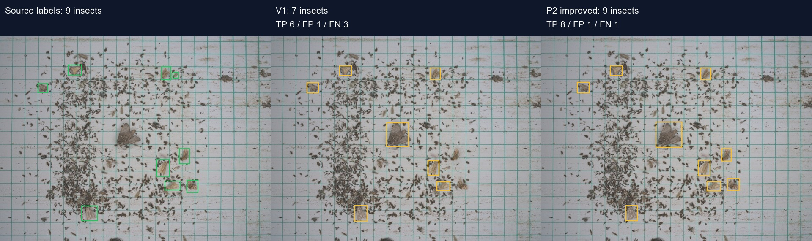
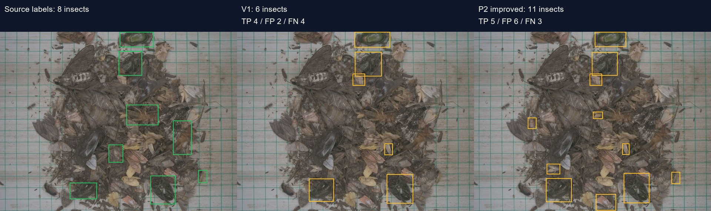

# So sánh bản 1 và P2 cải thiện — 09/11/2026

P2 tốt hơn trên cả F1 và sai số đếm của tập kiểm thử này. Chênh lệch F1: +10.25 điểm phần trăm; MAE: -2.13 con/ảnh.

Đã huấn luyện lại P2 bằng nhãn nguồn, giữ các nhánh P3/P4/P5 đã học và bổ sung nhánh P2. Đây là bộ phát hiện một lớp côn trùng; bộ nhận diện sáu loài giữ nguyên. Chưa thay model trên web.

Tập đánh giá: 197 ảnh bẫy, 2.445 box nhãn nguồn; train/validation/test không trùng ảnh chính xác. Chọn checkpoint và ngưỡng bằng validation trước khi mở test trong lần chạy này. Tập test này đã xuất hiện trong báo cáo bản 1 trước đây, chưa phải bộ ảnh thực địa mới.

| Chỉ số | Bản 1 | P2 cải thiện |
|---|---:|---:|
| Precision | 73.02% | 70.18% |
| Recall | 35.75% | 49.78% |
| F1 | 48.00% | 58.24% |
| Sai số đếm MAE (con/ảnh) | 6.51 | 4.38 |
| Ngưỡng chọn từ validation | 0.550 | 0.525 |
| Trung vị thời gian GPU (ms/ảnh, có cắt ô) | 52.6 | 110.8 |

Precision là tỷ lệ khung dự đoán khớp nhãn nguồn; recall là tỷ lệ cá thể trong nhãn nguồn được tìm thấy. MAE là trung bình độ lệch tuyệt đối của số đếm theo ảnh. Các chỉ số này không phải xác suất đúng của mỗi dự đoán.

Ở cùng ngưỡng cố định 0,55 đã đặt trước phép đo, precision bản 1/P2 lần lượt là 73.02% / 73.04%, recall 35.75% / 46.42%, F1 48.00% / 56.76%, MAE 6.51 / 4.92 con/ảnh. Cải thiện không chỉ đến từ việc hạ ngưỡng.

Recall với box có căn diện tích dưới 32 pixel ở ảnh nguồn: 33.20% → 53.37%.

## Giới hạn

Nhãn công khai có thể thiếu côn trùng nhỏ, chưa được chuyên gia xác minh độc lập. Các nhóm theo tên ảnh chưa được chứng minh là ngày hoặc bẫy độc lập. Precision/recall trên đây đánh giá detector một lớp bằng PyTorch FP32 trên RTX 4050; không phải độ chính xác phân loại sáu loài, toàn bộ pipeline hai model hoặc tốc độ trình duyệt. mAP toàn ảnh, chỉ số cùng ngưỡng 0.55 và recall theo kích thước có trong evaluation/comparison.json.

## Sử dụng

Model mới: models/PTIT_InsectDetector_P2_CaiThien_v1.pt. ONNX và model.json dùng RGB /255, letterbox 640, nền 114. Gói có core suy luận hỗ trợ cả 8400/34000 điểm; không chép riêng ONNX vào core cũ chỉ hỗ trợ 8400. Đây là gói AI để tích hợp, không phải website độc lập. Giữ ONNX Runtime Web 1.22.0, model nhận diện sáu loài và ngưỡng loài 0.70/margin 0.15 như bản hiện tại.

Chạy test: `node inference/test-insect-core.cjs`. Mã huấn luyện/so sánh trong scripts, môi trường chạy: Ultralytics 8.4.203, torch 2.7.1+cu126; dữ liệu/cache nằm ngoài OneDrive. NWD chưa được tích hợp; không công bố tính năng đó.

## Ví dụ được chọn trước khi đo test

8649_real_219316543.jpg

8614_real_219290104.jpg

8978_real_219123595.jpg

## Kiểm tra WebAssembly

ONNX Runtime Web 1.22.0, một luồng, chạy trong Node trên cùng một tensor 640×640: trung vị bản 1 763.0 ms, P2 2037.5 ms. Đã làm nóng 4 lượt rồi đo 8 lượt. Đây là một lượt chạy detector; chưa gồm toàn bộ các ô ảnh, model sáu loài, tải mạng và giao diện trình duyệt. Thời gian WASM dao động đáng kể trong lần đo; cần đo lại toàn luồng trên máy demo để chốt độ trễ thực tế.

## Tài liệu kỹ thuật

- [Kiến trúc P2 tham khảo của Ultralytics](https://github.com/ultralytics/ultralytics/blob/main/ultralytics/cfg/models/v8/yolov8-p2.yaml)
- [Ultralytics Train](https://docs.ultralytics.com/modes/train/)

Ghi chú dọn dự án: báo cáo này là so sánh lịch sử. Các bản sao script/core, checkpoint v1 và ONNX sáu loài đã bỏ khỏi gói này; mã dùng chung ở `scripts/`, core và ONNX sáu loài ở `infra/cloudflare/ai/`. Checkpoint P2 và ONNX P2 lịch sử được giữ để đối chiếu.
