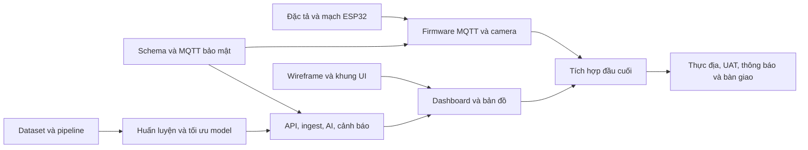

# Đánh giá đầy đủ bảng phân công

**Ngày đánh giá:** 26/10/2026. **Nguồn:** [bảng phân công của nhóm](https://docs.google.com/spreadsheets/d/1kbjhxIWivJ_RlBTpdRQFfNxxPTZlrTjd/edit?gid=1054760256#gid=1054760256). Đây là đánh giá phạm vi và tiêu chí nghiệm thu, không xác nhận các thành viên khác đã thực hiện xong.

## 1. Khối lượng và độ nhất quán

24 tác vụ trong 3 tuần, mỗi tuần 8 tác vụ, mỗi thành viên 6 tác vụ. Có 13 tác vụ ưu tiên Cao. Theo trạng thái chi tiết trong nguồn: 16 “Đang thực hiện”, 8 “Chưa thực hiện”, chưa có dòng “Đã hoàn thành”.

Các điểm cần sửa trong bảng nguồn, chưa thay đổi trực tiếp:

1. Tên Trung ở chi tiết viết “Trumg” cả 6 dòng, trong tổng hợp là “Trung”, dẫn tới tổng tác vụ/tiến độ đếm 0. Nên chuẩn hóa tên bằng mã thành viên và danh sách chọn.
2. “P Minh” ở chi tiết khác “Phạm Minh” tại tổng hợp, cũng đếm 0. Cần cùng quy tắc chuẩn hóa.
3. M1 ghi “Đã nghiệm thu” trong khi các dòng tuần 1 vẫn “Đang thực hiện”. Cần cập nhật bằng minh chứng từng phần, sau đó mới nghiệm thu toàn mốc.
4. Chưa có ngày bắt đầu cụ thể nên “Ngày 7/14/21” chỉ là mốc tương đối. Không tự suy ra hạn lịch từ ngày tạo/sửa file.
5. Cột nộp tài liệu còn trống. Nên gắn link repo, báo cáo, kết quả kiểm thử, phiên bản model và bộ dữ liệu tương ứng.
6. Broker đang ưu tiên Trung bình nhưng là điều kiện để firmware và backend tuần 2 tích hợp. Đề nghị nâng thành Cao trong kế hoạch thực hiện.
7. Tiêu chí AI “mAP50 >85%”, “Accuracy >90%” và “nhận diện sâu >90%” đang dùng các thước đo khác nhau. Cần chốt mAP50, mAP50–95, precision/recall theo lớp và thời gian suy luận cho từng giai đoạn.

## 2. Đánh giá cả 24 tác vụ

| Mã | Tuần / Người | Nội dung và bàn giao trong nguồn | Đánh giá, phụ thuộc và tiêu chí cần bổ sung |
|---|---|---|---|
| W1-L1 | 1 / Lộc | Khảo sát nhiệt độ, độ ẩm đất/không khí, camera; đặc tả và kê khai phần cứng | Hợp lý để mở đầu. Chốt loại cảm biến, dải đo, điện áp, sai số, giao tiếp, tần suất lấy mẫu, giá/nguồn cấp; độ ẩm đất cần quy đổi/hiệu chuẩn, không coi ADC là %. |
| W1-L2 | 1 / Lộc | Lắp ESP32 + DHT22/SHT30; breadboard và sơ đồ | Chọn một cấu hình chính, tránh đổi chân và driver muộn. Bàn giao pinout, ảnh mạch, firmware đọc mẫu, log đo ổn định và lỗi mất cảm biến. |
| W1-K1 | 1 / Khởi | 3.000+ ảnh sâu tơ/rầy nâu/bọ trĩ; Pascal VOC | Khối lượng lớn trong một tuần. Cần nguồn/quyền sử dụng, phân bố từng lớp, quy tắc gán nhãn, loại ảnh trùng và tách train/validation/test theo địa điểm/phiên chụp. Ảnh tăng cường không thay thế số ảnh gốc. |
| W1-K2 | 1 / Khởi | Lọc nhiễu, cân bằng sáng, augmentation | Pipeline phải tái lập, giữ đúng bounding box. Bổ sung cấu hình, seed, kiểm tra ảnh–nhãn, thống kê trước/sau xử lý; chỉ tăng cường tập train. |
| W1-T1 | 1 / Trung | PostgreSQL + Time-series DB; schema và kiến trúc | Được thực hiện trong bộ bàn giao này. Cần ERD, khóa/FK/check/index, dữ liệu mẫu, truy vấn, chính sách lưu và kiểm thử thật. Chọn TimescaleDB ngay trong PostgreSQL để dùng cùng giao dịch và FK. |
| W1-T2 | 1 / Trung | EMQX/Mosquitto và bảo mật; broker nhận telemetry | Được thực hiện bằng Mosquitto. Cần TLS, CA/SAN, tài khoản riêng, ACL, QoS, quy ước topic/payload và kiểm thử truy cập sai; broker không tự kiểm tra JSON hoặc tự ghi PostgreSQL. |
| W1-M1 | 1 / P Minh | Nghiên cứu nông dân, wireframe Figma | Cần tình huống mất mạng, cảnh báo dễ hiểu, màu/mức nguy cơ và thao tác trên điện thoại. Bàn giao màn hình, luồng và link Figma có quyền xem; kiểm tra với người dùng đại diện. |
| W1-M2 | 1 / P Minh | Khung React Native/Next.js, Design System | Chốt nền tảng chính sớm để tránh làm đồng thời web và mobile trong 3 tuần. Cần repo chạy được, token màu/chữ/khoảng cách và các trạng thái loading/empty/error. |
| W2-L1 | 2 / Lộc | Wi-Fi/4G, MQTT; firmware v1.0 thực tế | Phụ thuộc W1-T2. Cần xác minh CA, NTP, reconnect/backoff, QoS1, message_id không đổi khi gửi lại và log hoạt động với broker thật. Chốt có thực sự dùng 4G hay chỉ phương án dự phòng. |
| W2-L2 | 2 / Lộc | Camera định kỳ, Deep Sleep; module và báo cáo điện | Phụ thuộc nguồn cấp/phần cứng camera. Định nghĩa chu kỳ chụp/gửi, kích thước JPEG, lưu tạm, đánh thức và đo dòng thực. Ảnh đi HTTPS/object storage, tránh nhồi vào topic telemetry. |
| W2-K1 | 2 / Khởi | Huấn luyện YOLOv8; checkpoint mAP50 >85% | Phụ thuộc dữ liệu tuần 1. Bàn giao split cố định, config train, model version, confusion matrix và kết quả trên tập test độc lập. Chốt thiết bị dùng train/infer. |
| W2-K2 | 2 / Khởi | ONNX/TensorRT/Quantization; ONNX/TFLite | Chỉ chọn định dạng phù hợp phần cứng đích. Bổ sung benchmark trước/sau, kích thước và mức giảm mAP. Định dạng đầu vào/đầu ra phải thống nhất backend. |
| W2-T1 | 2 / Trung | REST API + WebSocket, nhận cảm biến/ảnh; Docker API | Phụ thuộc schema/topic tuần 1 và UI. Cần auth theo vườn, OpenAPI, giới hạn tải, phân trang, kiểm tra payload, ingest retry/dedup, object storage và hợp đồng event. |
| W2-T2 | 2 / Trung | Tích hợp AI và cảnh báo vi khí hậu; module nguy cơ | Phụ thuộc model và quy tắc nghiệp vụ. Chạy suy luận bất đồng bộ, lưu model_version, timeout/retry, cooldown. Ngưỡng demo chưa phải kết luận nông học; cần người có chuyên môn xác nhận trước khuyến cáo. |
| W2-M1 | 2 / P Minh | Dashboard biểu đồ nhiệt/ẩm thời gian thực | Phụ thuộc REST/WebSocket. Phải thể hiện đơn vị, múi giờ, khoảng thời gian, dữ liệu thiếu, trạm offline và reconnect. Không trộn thời gian đo với thời gian máy chủ nhận. |
| W2-M2 | 2 / P Minh | Bản đồ bẫy và ảnh/bounding box | Phụ thuộc GPS/vị trí và hợp đồng AI. Cần tọa độ, tỷ lệ ảnh, quy ước bbox chuẩn hóa, chú giải lớp, độ tin cậy và phân quyền ảnh. |
| W3-L1 | 3 / Lộc | Hộp IP66 và lắp vườn; trạm hoạt động ngoài trời | Hộp ghi IP66 không tự chứng minh cả trạm đạt IP66 sau khoan/lắp. Cần kiểm tra nước, ngưng tụ, nguồn, an toàn lắp và log chạy liên tục; ghi rõ điều kiện, thời lượng thử. |
| W3-L2 | 3 / Lộc | Mạng thực địa và bảo trì; hướng dẫn | Đo tỷ lệ mất gói, thời gian kết nối lại, mất điện/mất mạng. Hướng dẫn thay cảm biến, hiệu chuẩn, vệ sinh, đổi mật khẩu và phục hồi trạm. |
| W3-K1 | 3 / Khởi | Tinh chỉnh thực địa; Accuracy >90% | Cần làm rõ chỉ số như mục 1. Chốt tập test ngoài vườn độc lập, điều kiện ngày/đêm, từng loài và báo cáo lỗi âm tính/dương tính. |
| W3-K2 | 3 / Khởi | Khuyến cáo phòng trừ; CSDL khuyến cáo theo loài | Cần nguồn chuyên môn, cây trồng/giai đoạn, phiên bản, ngày kiểm tra và người duyệt. Khuyến cáo hóa học phải đúng thuốc/nhãn/quy định hiện hành; không tự sinh phác đồ từ dự đoán AI. |
| W3-T1 | 3 / Trung | Zalo/Telegram; webhook cảnh báo tức thì | Chọn một kênh demo chính. Cần token bí mật, consent người nhận, chống gửi trùng, retry/rate limit, trạng thái giao nhận và số đo độ trễ. |
| W3-T2 | 3 / Trung | Hiệu năng, backup, bảo mật; stress test/auto-backup | Cần số thiết bị/tần suất cụ thể, p95 latency, lỗi/giây, RPO/RTO, bản sao ngoài máy chủ và bài restore thật. Không chỉ chứng minh đã tạo file backup. |
| W3-M1 | 3 / P Minh | Thông báo và báo cáo PDF dịch hại | Phụ thuộc API/thông báo. Kiểm tra dữ liệu/mốc thời gian/tên vườn, tiếng Việt trên PDF, quyền tải và trạng thái đã đọc. |
| W3-M2 | 3 / P Minh | UAT, sửa UI, đóng gói/video demo | Cần kịch bản đầu cuối, danh sách lỗi ưu tiên, người nghiệm thu và hướng dẫn chạy từ máy sạch. Video chỉ là bằng chứng bổ sung, không thay kiểm thử. |

## 3. Chuỗi phụ thuộc và đề xuất điều phối

Kế hoạch 3 tuần phù hợp một nguyên mẫu thử nghiệm có phạm vi hẹp. Các mục 3.000 ảnh thực địa, model theo nhiều môi trường, IP66 và hai kênh thông báo có rủi ro vượt thời gian. Nên chốt một loại cây/vườn, một cấu hình trạm, một nền tảng UI và một kênh thông báo; giữ các lựa chọn còn lại làm phương án mở rộng.

Đề xuất điểm chốt trong tuần 1: ngày 1 thống nhất cảm biến/đơn vị/topic; ngày 2–3 chốt ERD và JSON Schema; ngày 4 chạy TLS/ACL; ngày 5–6 đo–gửi–nhận với ESP32; ngày 7 đối chiếu minh chứng và ký nghiệm thu. Đây là kế hoạch đề xuất, không phải lịch đã được nhóm xác nhận.

M1 cần đủ minh chứng từ cả bốn thành viên. Bộ bàn giao này chỉ đủ để đánh giá phần Backend & Cloud của Trung; không tự xác nhận toàn mốc hoặc thay đổi trạng thái của người khác.
