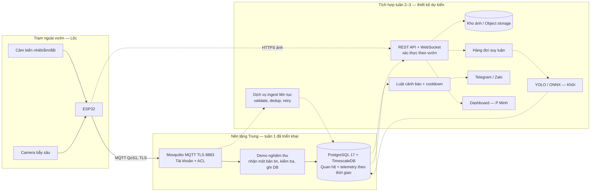

# Kiến trúc hệ thống IoT & AI cảnh báo sớm sâu bệnh hại

**Phần bàn giao:** Trung — tuần 1. **Phiên bản thiết kế:** 1.0, ngày 26/10/2026.

## 1. Quyết định kiến trúc

PostgreSQL quản lý người dùng, vườn, lô, thiết bị, ảnh và kết quả nhận diện. TimescaleDB là extension cùng instance PostgreSQL, quản lý chuỗi thời gian cảm biến bằng hypertable. Cách này đáp ứng hai loại dữ liệu mà vẫn giữ khóa ngoại và giao dịch SQL, giảm số dịch vụ phải vận hành trong nguyên mẫu 3 tuần. Không triển khai thêm InfluxDB khi chưa có nhu cầu cụ thể.

Mosquitto tiếp nhận MQTT qua TLS. Mỗi trạm có username/mật khẩu riêng và quyền ghi chính xác hai topic của mình. Tài khoản backend đọc telemetry/status. Dữ liệu môi trường đi MQTT; ảnh JPEG đi HTTPS tới API/object storage ở tuần 2. Không lưu ảnh nhị phân trong bảng time-series.

Nét liền bên trong khối tuần 1 thể hiện thành phần đã chạy. Mũi tên ESP32 là giao diện đã thiết kế; chưa kiểm thử bằng phần cứng thật. Nét đứt thể hiện tích hợp dự kiến, chưa phải tính năng đã triển khai.

## 2. Luồng telemetry và tính đúng dữ liệu

1. ESP32 lấy mẫu, đồng bộ NTP, tạo `message_id` UUID và `observed_at` UTC. Khi gửi lại cùng mẫu, giữ nguyên hai giá trị này.
2. Kết nối TLS có xác minh CA và tên/IP trong SAN; xác thực tài khoản riêng. Gửi QoS1, không retain telemetry.
3. Broker kiểm tra tài khoản và ACL. Broker không kiểm tra JSON Schema, không ghi DB và không biết `devices.enabled` trong PostgreSQL.
4. Demo tuần 1 hoặc ingest tuần 2 đối chiếu topic với payload, kiểm tra đơn vị/miền giá trị, thời gian từ hiện tại−7 ngày tới hiện tại+5 phút; xác nhận thiết bị tồn tại, thuộc đúng vườn và đang enabled.
5. Ghi bằng truy vấn tham số hóa, `ON CONFLICT (device_id,observed_at,message_id) DO NOTHING`. MQTT QoS1 có thể giao nhiều lần, cơ sở dữ liệu chỉ nhận một dòng cho cùng mẫu.
6. Lưu `received_at` riêng để theo dõi độ trễ. API tương lai hiển thị thời gian đo, chuyển sang UTC+7 ở giao diện.

Broker có thể lưu hàng đợi và trạng thái phiên, nhưng chưa phải hàng đợi xử lý bền vững từ MQTT tới DB. Demo hiện tại dùng phiên ngắn để nghiệm thu; ingest tuần 2 phải dùng persistent session, kiểm soát ACK sau khi commit, retry và hàng đợi lỗi. Không gọi toàn chuỗi là “exactly-once”.

## 3. Phân tách trách nhiệm

| Thành phần | Trách nhiệm | Thời điểm |
|---|---|---|
| ESP32 | Đọc cảm biến, thời gian đo, UUID, kết nối TLS/reconnect | Firmware Lộc tuần 2 |
| Broker | TLS, xác thực, phân quyền topic, QoS, chuyển tiếp | Trung tuần 1 |
| SQL/TimescaleDB | Khóa, ràng buộc dữ liệu, lưu/tra cứu theo thời gian, aggregate/retention | Trung tuần 1 |
| Demo nghiệm thu | Nhận một bản tin mới và ghi DB; kiểm tra gửi lặp | Trung tuần 1 |
| Ingest liên tục/API | Hàng đợi, auth người dùng, phân quyền vườn, REST/WebSocket, nhận ảnh | Trung tuần 2 |
| AI | Dataset, nhãn lớp, phiên bản model và suy luận | Khởi tuần 1–2 |
| Cảnh báo/thông báo | Ngưỡng đã được duyệt, cooldown, gửi/nhận có retry | Trung tuần 2–3 |
| UI | Biểu đồ, bản đồ, ảnh và trạng thái kết nối | P Minh tuần 1–3 |

## 4. Biên bảo mật

- MQTT: chỉ mở 8883 TLS, không cấu hình listener 1883; server certificate, TLS tối thiểu 1.2, username/password và ACL. Đang dùng xác thực server TLS, không yêu cầu client certificate/mTLS.
- Mặc định cả MQTT và PostgreSQL chỉ bind loopback. Triển khai LAN/cloud phải cấp SAN đúng hostname/IP, điều chỉnh bind có chủ đích và mở đúng cổng cần thiết.
- PostgreSQL: admin cho cài đặt, `iot_ingest` chỉ đọc registry và thêm telemetry/cập nhật `last_seen_at`, `iot_app` là tài khoản dịch vụ API tin cậy, không phải superuser và không có quyền CREATE schema.
- Role API truy cập dữ liệu nhiều vườn: chưa có row-level security ở tuần 1. API tuần 2 phải tra `farm_members` và bắt buộc lọc theo farm được cấp quyền; tuyệt đối không cấp role DB cho trình duyệt/ứng dụng người dùng.
- Mật khẩu, khóa TLS và CA private key tự sinh, nằm trong `.secrets/`, không hard-code hay đóng gói. Chỉ chia sẻ CA public certificate và tài khoản đúng trạm cho Lộc.
- Thu hồi thiết bị cần cả vô hiệu hóa DB registry và xóa/đổi mật khẩu MQTT + reload/restart broker. Tắt `enabled` ở DB không tự thu hồi phiên MQTT đang kết nối.

## 5. Lưu trữ và quy mô giả định

Telemetry raw: hypertable chunk 1 ngày, giữ 90 ngày. Aggregate theo giờ: giữ 365 ngày, refresh 15 phút, lấy lại tối đa 8 ngày để bao phủ độ trễ 7 ngày và ranh giới bucket. Giờ gần hiện tại được đọc qua real-time aggregate; bản tin đến muộn có thể đợi lần refresh tiếp theo.

Ví dụ tính tải thiết kế, chưa phải kết quả benchmark: 10 trạm × 1 mẫu/phút = 14.400 mẫu/ngày, 1.296.000 mẫu/90 ngày. 100 trạm tạo 12.960.000 mẫu/90 ngày. Dung lượng phải đo bằng `pg_total_relation_size` và dữ liệu thực, không suy từ kích thước JSON. Stress test/backup/restore đầy đủ thuộc tuần 3.

## 6. Tham khảo kỹ thuật đã đối chiếu

- [TimescaleDB — create_hypertable và by_range](https://www.tigerdata.com/docs/reference/timescaledb/hypertables/create_hypertable)
- [TimescaleDB — cài đặt self-hosted, gồm Windows](https://www.tigerdata.com/docs/get-started/choose-your-path/install-timescaledb)
- [Mosquitto — cấu hình TLS, tài khoản và ACL](https://www.mosquitto.org/man/mosquitto-conf-5.html)
- [PostgreSQL — binary Windows chính thức được dẫn tới EDB](https://www.postgresql.org/download/windows/)

Các lựa chọn chu kỳ, retention và mô hình phân quyền ở trên là thiết kế đề xuất cho dự án, không phải thông số bắt buộc từ các tài liệu tham khảo.
