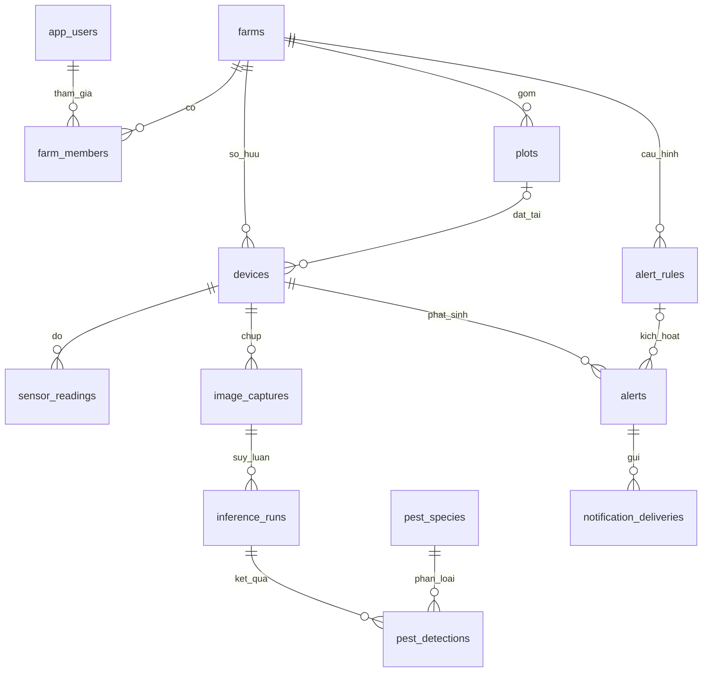

# Thiết kế cơ sở dữ liệu

**Trung — tuần 1**, PostgreSQL 17.11 + TimescaleDB 2.23.1. Nguồn thực thi là `database/init/001_schema.sql` tới `004_grants.sql`; tài liệu này mô tả quyết định và cách sử dụng.

## 1. ERD



13 bảng trong schema `iot`, cộng continuous aggregate `iot.telemetry_hourly`. Các bảng AI/cảnh báo/thông báo là cấu trúc dự trù; chưa có dịch vụ nghiệp vụ tương ứng trong tuần 1.

## 2. Từ điển dữ liệu quan hệ

Ký hiệu `?` là có thể NULL. Tất cả UUID do PostgreSQL `gen_random_uuid()` sinh nếu không truyền vào, trừ khóa ngoại. Mặc định thời gian lưu bằng `timestamptz`, session UTC.

| Bảng | Trường và kiểu dữ liệu chính | Khóa/ràng buộc/ý nghĩa |
|---|---|---|
| `app_users` | `id uuid`, `auth_subject text`, `display_name text`, `created_at timestamptz` | PK id; UNIQUE auth_subject; tham chiếu định danh từ hệ thống auth tương lai, không lưu mật khẩu tài khoản người dùng |
| `farms` | `id text`, `name text`, `timezone text`, `created_at timestamptz` | PK id dạng slug an toàn topic; timezone mặc định Asia/Ho_Chi_Minh |
| `farm_members` | `farm_id text`, `user_id uuid`, `role text` | PK (farm,user); FK farms/users; role owner/operator/viewer |
| `plots` | `id uuid`, `farm_id text`, `name text`, `crop text?`, `area_m2 numeric?` | FK farm; diện tích >0; UNIQUE (id,farm_id) cho FK tổng hợp |
| `devices` | `id text`, `farm_id text`, `plot_id uuid?`, `name text`, `mqtt_username text`, `hardware_model text?`, `firmware_version text?`, `latitude float8?`, `longitude float8?`, `enabled boolean`, `installed_at timestamptz`, `last_seen_at timestamptz?` | PK id toàn hệ thống; UNIQUE mqtt_username; FK (plot_id,farm_id) ngăn gán thiết bị vào lô vườn khác; vĩ độ −90..90, kinh độ −180..180 |
| `image_captures` | `id uuid`, `device_id text`, `farm_id text`, `captured_at timestamptz`, `object_key text`, `sha256 text`, `width_px int`, `height_px int` | FK (device,farm); object_key duy nhất; SHA256 gồm 64 ký tự hex thường; kích thước >0; chỉ lưu metadata ảnh |
| `pest_species` | `code text`, `vietnamese_name text`, `scientific_name text` | PK code; seed 3 nhãn phục vụ trao đổi với AI; bọ trĩ mới xác định tới bậc bộ, chờ Khởi xác nhận loài |
| `inference_runs` | `id uuid`, `image_id uuid`, `model_version text`, `status text`, `created_at timestamptz`, `completed_at timestamptz?`, `error_message text?` | FK ảnh; UNIQUE (image,model_version); queued/running/succeeded/failed; phân biệt lỗi suy luận với kết quả 0 sâu |
| `pest_detections` | `id bigint identity`, `inference_id uuid`, `pest_code text`, `confidence float8`, `x_min/y_min/x_max/y_max float8` | FK inference/species; confidence 0..1; bbox chuẩn hóa xyxy, 0≤min<max≤1; không dùng bbox pixel |
| `alert_rules` | `id uuid`, `farm_id text`, `name text`, `metric text`, `operator text`, `threshold float8`, `window_minutes int`, `cooldown_minutes int`, `enabled boolean` | metric thuộc bộ cảm biến/pest_count; gt/gte/lt/lte; ngưỡng hữu hạn; cửa sổ 1..10080 phút; mặc định rule disabled, chưa tự khẳng định nguy cơ nông học |
| `alerts` | `id uuid`, `farm_id text`, `device_id text`, `rule_id uuid?`, `severity text`, `message text`, `triggered_at timestamptz`, `acknowledged_at timestamptz?` | FK tổng hợp bảo đảm device/rule cùng farm; severity info/warning/critical |
| `notification_deliveries` | `id bigint identity`, `alert_id uuid`, `channel text`, `recipient_ref text`, `status text`, `attempts int`, `sent_at timestamptz?` | FK alert; telegram/zalo; pending/sent/failed; UNIQUE (alert,channel,recipient_ref) chống tạo hai yêu cầu gửi cùng đích |

Không cascade xóa dữ liệu lịch sử khi xóa vườn/thiết bị: FK mặc định chặn xóa còn tham chiếu. Khi ngừng dùng trạm, đặt `devices.enabled=false`; quy trình thu hồi tài khoản MQTT thực hiện riêng.

## 3. Bảng chuỗi thời gian `sensor_readings`

| Cột | Kiểu / bắt buộc | Quy tắc |
|---|---|---|
| `observed_at` | timestamptz / có | Thời điểm đo do thiết bị gửi, không quá received_at+5 phút |
| `received_at` | timestamptz / có | Mặc định now() phía DB; khác thời điểm đo |
| `device_id` | text / có | Cùng farm_id tham chiếu devices |
| `farm_id` | text / có | Vườn quản lý trạm |
| `message_id` | uuid / có | Giữ nguyên khi gửi lại mẫu |
| `temperature_c` | float8 / không | −40..125 °C; giới hạn hợp đồng chung, không phải cam kết độ chính xác cảm biến |
| `air_humidity_pct` | float8 / không | 0..100 %RH |
| `soil_moisture_pct` | float8 / không | 0..100 %, sau hiệu chuẩn; không nhận giá trị ADC nguyên gốc |
| `battery_v` | float8 / không | 0..30 V, tùy cấu hình nguồn thực tế |
| `rssi_dbm` | smallint / không | −127..0 dBm |

Ít nhất một trong ba phép đo môi trường phải có. Cảm biến không gắn hoặc lỗi được bỏ trường ở JSON/để NULL ở SQL; không thay bằng 0. Các miền giá trị loại NaN/infinity tại DB, và bộ kiểm tra payload cũng chặn số không hữu hạn.

PK `(device_id,observed_at,message_id)` chứa cột thời gian để thỏa điều kiện unique index của hypertable. Cùng UUID nhưng thay observed_at là một khóa khác; firmware phải giữ timestamp gốc khi retry. Không tuyên bố UUID được unique toàn hypertable độc lập thời gian.

Index PK phục vụ truy vấn theo thiết bị và khoảng thời gian. Index `(farm_id,observed_at DESC)` phục vụ Dashboard theo vườn. Alert có index `(farm_id,triggered_at DESC)`. Mọi truy vấn Dashboard cần giới hạn thời gian và số dòng.

## 4. Thiết kế TimescaleDB

```sql
SELECT create_hypertable('iot.sensor_readings',
  by_range('observed_at', INTERVAL '1 day'));
```

Raw giữ 90 ngày theo thời gian đo. `telemetry_hourly` tổng hợp theo farm, device và bucket 1 giờ, bao gồm số mẫu, trung bình/min/max nhiệt độ, trung bình độ ẩm không khí/đất. Aggregate giữ 365 ngày, tự refresh mỗi 15 phút, tính lại vùng từ hiện tại−8 ngày tới hiện tại−1 giờ. Phần mới hơn mốc vật hóa được truy vấn qua real-time aggregation.

Policy được background worker thực hiện theo lịch, không xóa ngay đúng từng giây tại mốc retention. Giới hạn nhận bản tin muộn 7 ngày ở tầng ingest giúp dữ liệu không rơi ngoài cửa sổ refresh. Số mẫu dùng `count(*)`; giá trị AVG tự bỏ NULL nên khi cần đánh giá chất lượng từng cảm biến ở tuần 2 phải bổ sung số mẫu hợp lệ từng metric.

## 5. Tài khoản DB

| Role | Quyền |
|---|---|
| `iot_admin` | Chủ DB, cài extension/schema và vận hành. Không dùng cho API/ingest |
| `iot_ingest` | USAGE schema; SELECT devices; INSERT/SELECT sensor_readings; UPDATE riêng last_seen_at trên devices |
| `iot_app` | CRUD các bảng nghiệp vụ, sequence; không superuser, không CREATE schema. Chỉ cấp cho dịch vụ API tin cậy |

Password riêng được tạo ngẫu nhiên ở bootstrap. Cả native và Docker dùng SCRAM-SHA-256 cho kết nối TCP. PostgreSQL demo chỉ nghe loopback; TLS trên kết nối DB từ xa cần được cấu hình khi triển khai server/cloud. Không nhầm TLS MQTT hiện có với TLS PostgreSQL.

## 6. Dữ liệu mẫu và truy vấn

Seed tạo 1 user demo, 2 vườn, 1 lô, 2 trạm, 3 nhãn sâu và 1 mẫu cảm biến. Vườn thứ hai phục vụ kiểm thử không cho thiết bị vườn A ghi sang vườn B. Mọi dữ liệu seed/demo là dữ liệu tổng hợp.

`database/queries.sql` có truy vấn mẫu theo thiết bị, aggregate theo giờ và trạng thái hypertable/policy. API tuần 2 phải dùng tham số SQL, lọc quyền vườn và phân trang; không ghép chuỗi SQL từ request.

Kiểm thử nghiệm thu chạy trên TimescaleDB thật: có hypertable, đủ 2 retention policy + 1 refresh policy; FK/check thực thi; retry chỉ ghi một mẫu; role ingest không đọc user/xóa dữ liệu; aggregate của hai mẫu 20 và 30°C cho kết quả 25°C. Fixture aggregate được dọn sau kiểm thử.
